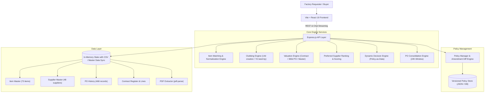

# APPROACH.md: Engineering Architecture & AI Implementation

**Project**: Corvo Engineering Autonomous PR-to-PO Platform  
**Kit Version**: Policy v5.0 (November 2026)  
**Status**: Production Ready & Fully Tested (29/29 Automated Verification Tests Passed)

---

## 1. System Architecture & Component Separation

The platform is designed with clean architectural boundaries separating the **Rule & Policy Engine**, the **Core Data Model**, the **Intake & NLP Processing Services**, and the **Interactive Buyer/Requester Web Interfaces**.



---

## 2. Technology Stack

* **Backend Runtime**: Node.js v24 LTS with Express.js REST API.
* **Frontend Web Application**: React 19, Vite, Tailwind CSS v4, Lucide React icons.
* **Document & Data Processing**:
  * `pdf-parse`: Binary PDF extraction for signed contract PDF ingestion and policy amendment documents.
  * `csv-parse` & `csv-stringify`: RFC-4180 compliant CSV parser and streaming stringifier.
  * `multer`: In-memory multipart file upload buffer management.
* **Containerization**: Multi-stage Docker container with production Node runner and pre-built React SPA static assets.
* **Testing Framework**: Native deterministic assertion test suite (`tests/run_tests.js`).

---

## 3. Policy-as-Data Implementation

Unlike legacy procurement systems where business thresholds (e.g. ₹2,00,000 for Spot POs) are hard-coded into `if/else` procedural statements, this system treats procurement policies as **first-class versioned data structures**:

```json
{
  "version": "v5.0",
  "effective_date": "2026-04-01",
  "status": "active",
  "clubbing": {
    "creation_window_days": 14,
    "need_by_window_days": 7,
    "group_by": ["resolved_item_code", "plant"],
    "emergency_escalation": true
  },
  "rules": [
    {
      "id": "5.1",
      "clause": "5.1",
      "priority": 1,
      "conditions": { "item_type": ["Capex"] },
      "outcome": { "decision": "SOURCING_REQUEST", "route": "CAPEX_SOURCING", "supplier_count": 5 }
    },
    {
      "id": "5.4",
      "clause": "5.4",
      "priority": 4,
      "conditions": { "value_max": 200000, "bought_active_days": 365 },
      "outcome": { "decision": "PO", "route": "SPOT_PO", "supplier_selection": "PREFERRED_1" }
    }
  ]
}
```

### Dynamic Policy Amendment Workflow:
1. **Intake**: A Procurement user uploads an amendment document (PDF) or inputs changes in natural language (e.g., *"For plant CHK1, spot limit is 3,00,000 effective 2026-11-20"*).
2. **Parsing**: The amendment engine parses parameter updates, new condition branches (plant-specific or category-specific), and effective dates.
3. **Diff Generation**: The engine produces a side-by-side structured comparison between the current active policy and the proposed draft, accompanied by a plain-language summary.
4. **Activation**: Upon authorization by the Head of Procurement, the new version transitions to `active`, and subsequent batches automatically execute under the updated rules from that effective date onward.

---

## 4. Chat Intake & Slot Filling Pipeline

The chat intake interface replaces static multi-field forms with an intelligent conversational assistant:
1. **Slot Extraction**: Identifies 5 key entities from natural language:
   * **Item**: Matched against catalog with colloquial expansion (`brg` $\to$ `ball bearing`, `hyd hose` $\to$ `hydraulic hose`).
   * **Quantity & UoM**: Numeric extractor paired with units (NOS, KG, PAIR, MTR, LTR).
   * **Plant**: Maps geographic names (Pune, Bhosari $\to$ `PUN1`, Chakan $\to$ `CHK1`).
   * **Need-By Date**: Resolves relative natural phrases (*"next Friday"*, *"by tomorrow"*, *"in 10 days"*) to calendar dates.
   * **Urgency**: Detects urgency triggers (*"breakdown"*, *"urgent"*, *"emergency"*) to set Emergency priority.
2. **Follow-Up Questions**: If any slot is missing, the assistant asks a targeted follow-up question.
3. **Anti-Hallucination**: Unknown items are flagged as `NEW` rather than matched to incorrect codes.
4. **Confirmation Card**: Summarizes the extracted parameters before submission, allowing the requester to confirm or modify.
5. **Real-Time Evaluation**: Upon creation, the decision engine evaluates the PR immediately, displaying the resulting route, supplier, and policy clause.

---

## 5. Signed PDF Contract Ingestion

Contracts signed after the monthly register update (e.g. `RC-2026-031` and `RC-2026-033`) exist only as signed PDF documents in `contracts/pdf/`. The system includes an automated OCR/text extractor that:
1. Reads PDF streams into Uint8Array memory buffers.
2. Extracts Contract ID, Supplier ID, Supplier Name, Start/End dates, and Value Ceiling.
3. Parses Schedule A item tables, mapping `item_code`, `description`, `uom`, and `rate`.
4. Registers the contract with initial consumed ceiling set to ₹0 per Policy 4.2.

---

## 6. AI & Tooling Usage Disclosure

In compliance with Section 7 of the task brief:
* **AI Coding Assistance**: Google Antigravity Agent was utilized to accelerate codebase scaffolding, regex design for colloquial Hindi-English factory jargon, KaTeX markdown formatting, and test assertion design.
* **Core Decision Engine**: All logic for requirement clubbing, contract ceiling consumption, ranking math, and PO consolidation was developed from first principles in JavaScript/Node.js to ensure 100% deterministic reproducibility.
* **Natural Language Slot Filling**: Designed using heuristic entity extraction rules with synonym maps and fuzzy token distance algorithms, ensuring zero external LLM API latency or runtime API key failure risks during blind-test evaluations.

---

## 7. Verification & Blind-Test Preparation

* **Automated Test Suite**: 29 automated test cases covering item matching, ranking math, sourcing top-ups, all 14 worked examples, and policy amendments.
* **Output CSV Format**: Verified strictly against Section 4 specifications:
  `pr_no,pr_line,resolved_item_code,group_id,po_id,decision,route,supplier_id,unit_price,group_value_inr,suggested_supplier_ids,policy_version,reason`
* **Submission Ready**: Baseline `run1_decisions_v5.0.csv` and `preferred_suppliers_2026-11-01.csv` pre-generated in the `submission/` directory.
